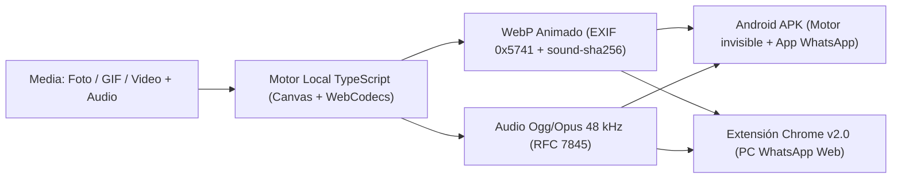

# 🔊 AudioSticker Studio

> **Crea y envía Stickers con Sonido reales (`🔊`) para WhatsApp** — en **APK Android nativa**, **Extensión de Chrome/Edge (PC)** y **Web PWA**, 100% local y sin servidores externos.


---

## ✨ ¿Qué hace único a AudioSticker Studio?

A diferencia de apps que solo convierten un video en `.mp4` normal, **AudioSticker Studio** compila el formato binario oficial de **Stickers con Sonido de WhatsApp** directamente en tu dispositivo (sin FFmpeg pesado y sin subir tus archivos a la nube):

- **WebP Animado (`512×512`, ≤ 1 MB)** con bloque **TIFF Big-Endian EXIF (`0x5741`)** que incluye `sound-sha256`, nombre de paquete y autor.
- **Audio `Ogg/Opus` 48 kHz mono** codificado localmente con **WebCodecs (`AudioEncoder`)** + muxer RFC 3533 / RFC 7845.
- **Envío real con bocina `🔊`**:
  - En **Android (APK)**: motor integrado invisible en segundo plano que, tras vincular 1 sola vez (código de 8 dígitos), envía el sticker real con bocina **`🔊`** al chat que elijas (o a tu chat **`⭐ Tú`**) y **abre automáticamente tu aplicación oficial de WhatsApp** sin volver a mostrar WhatsApp Web.
  - En **PC (Chrome/Edge)**: extensión **Manifest V3** que inyecta el envío real en `web.whatsapp.com` en 1 clic.

---

## 🚀 Funciones Principales

### 📱 App Android Nativa (`AudioSticker-Studio.apk`)
- **Carga instantánea de videos (<150 ms):** previsualización por hardware en vivo a 60 FPS sin congelar el teléfono ni explotar la RAM, sincronizada con el recorte de audio.
- **Recibe videos desde "Compartir":** comparte cualquier video, foto o audio directo desde **Galería, TikTok o WhatsApp** hacia **AudioSticker Studio** mediante streaming local (`ACTION_SEND` + `/_capacitor_file_`).
- **Arranque instantáneo 100% offline:** CSS local sin CDNs externos + codificador MP3 (`lamejs`) incluido en local.
- **Selector nativo de chats + apertura automática de WhatsApp oficial:** elige a qué contacto/grupo enviarlo o envíalo directo a tu chat **`⭐ Tú`**, o usa el botón directo de **Video MP4 a la app de WhatsApp** sin vincular nada.
- **Interfaz adaptable a cualquier pantalla:** soporta iPhone SE (320 px), iPhones con notch/Dynamic Island (`100dvh` + `safe-area-inset`), Androids pequeños/grandes, tablets y PC.

### 🎨 Editor Visual de Stickers (`512×512`)
- **Acepta Fotos (`PNG/JPG/WebP`), GIFs Animados y Videos (`MP4/WebM/MOV`).**
- **Quitar fondo automático** (flood-fill por bordes o croma global) + **cuentagotas manual** y tolerancia ajustable.
- **Borde blanco estilo sticker troquelado** con grosor ajustable.
- **Rebote reactivo al ritmo del audio** (`Beat Bounce`) cacheado por sprite para 60 FPS fluidos.
- **Texto meme** (arriba/abajo con color y contorno doble), encuadre táctil 1:1, zoom y rotación.

### 🎵 Editor Profesional de Audio
- **Onda interactiva con Zoom (`1×`, `4×`, `12×`)**, deslizador suave de posición, duración (`Máx 5s` / `Máx 10s`) y botones de ajuste fino (`-1s`, `-0.1s`, `+0.1s`, `+1s`).
- **Múltiples fuentes de sonido:** pista extraída automáticamente del video, archivos locales (`MP3/WAV/OGG/M4A`), enlaces de **MyInstants.com**, **grabación de voz en vivo con micrófono** y 5 efectos virales integrados (*Vine Boom, Bass Drop, Sparkle, Arcade, Airhorn*).
- **Control de volumen y Fade In/Out suave.**

### 📦 Formatos de Exportación
- 🔊 **Par Oficial WhatsApp (`.webp` Animado EXIF + `.ogg` Opus 48 kHz)**
- 🎬 **Video-Sticker `.mp4` (H.264 + AAC)** cuadrado `512×512` (con copia directa al portapapeles de archivos en Windows para pegar con `Ctrl + V`)
- ✨ **`.webm` Transparente (VP9 Alfa + Opus)**
- 📦 **Proyecto editable `.stiksound.zip`**
- 🖼️ **WebP estático (≤ 100 KB)** · 🎵 **MP3** · 🔊 **WAV**

---

## 🏗️ Arquitectura del Proyecto



### Estructura de carpetas
```text
├── src/
│   ├── main.ts                    # Controlador UI, video instantáneo, waveform y puentes nativos
│   ├── media-engine.ts            # Recorte 1:1, sprite cache, quitar fondo, MP4/WebM/MP3/WAV/ZIP
│   ├── whatsapp-sound-sticker.ts  # Compilador Ogg/Opus + TIFF EXIF 0x5741 + WebP Animado
│   ├── webp-riff-audio.ts         # Lector/inyector binario RIFF WebP
│   ├── myinstants.ts              # Extractor de sonidos desde MyInstants.com
│   ├── presets.ts                 # Efectos virales sintetizados y mascotas demo
│   └── types.ts                   # Tipos y límites oficiales de WhatsApp
├── chrome-extension/              # Extensión Chrome / Edge Manifest V3 (v2.0)
│   ├── manifest.json
│   ├── background.js
│   ├── content-studio.js
│   ├── content-wa-bridge.js
│   └── wa-main-sender.js          # Envío nativo vía módulos internos de WhatsApp
├── android/                       # Proyecto Nativo Android (Capacitor 8)
│   └── app/src/main/java/com/audiosticker/studio/
│       ├── MainActivity.java      # Share Target (ACTION_SEND) + motor invisible + bridge WhatsApp
│       └── PendingStickerStore.java
├── .github/workflows/
│   └── build-android-apk.yml      # Compilación automática de APK en GitHub Actions
├── index.html                     # Interfaz PWA/APK sin CDNs
├── styles.css                     # Estilos locales responsivos (320px a Desktop)
├── server.js                      # Servidor local + portapapeles nativo Windows (Ctrl+V)
└── AudioSticker-Studio.apk        # APK Android compilada lista para instalar
```

---

## 📲 Instalación y Uso

### 1. En Android (APK lista para instalar)
1. Descarga **[`AudioSticker-Studio.apk`](https://github.com/Straugter/AudioSticker-Studio/raw/main/AudioSticker-Studio.apk)** directamente en tu teléfono e instálala (permite *orígenes desconocidos* si Android lo solicita).
2. Abre la app o comparte un video directo desde tu **Galería / TikTok / WhatsApp → AudioSticker Studio**.
3. Recorta el audio (opcional) y pulsa **`🔊 ENVIAR STICKER REAL A APP WHATSAPP`**.
4. La primera vez te pedirá vincular **1 sola vez** (código de 8 dígitos en *WhatsApp → Dispositivos vinculados*). Después, el envío ocurre en segundo plano y abre directo tu **app oficial de WhatsApp**.

### 2. En PC (Web + Extensión de Chrome / Edge)
```bash
git clone https://github.com/Straugter/AudioSticker-Studio.git
cd AudioSticker-Studio
npm install
npm run build
npm start
```
1. Abre **`http://localhost:3000`**.
2. Para activar el envío de **Stickers Reales con Sonido (`🔊`)** en PC:
   - Abre `chrome://extensions/` (o `edge://extensions/`).
   - Activa **Modo de desarrollador**.
   - Haz clic en **Cargar descomprimida** y selecciona la carpeta `chrome-extension/`.
   - Abre o recarga **`https://web.whatsapp.com`**.

### 3. Compilar la APK tú mismo desde el código fuente
Requiere **Node.js 20+**, **JDK 21** y **Android SDK**:
```bash
npm install
npm run typecheck
npm run cap:sync
cd android
./gradlew assembleDebug
```
El archivo generado aparecerá en `android/app/build/outputs/apk/debug/app-debug.apk` (también se compila automáticamente con GitHub Actions en `.github/workflows/build-android-apk.yml`).

---

## 🛠️ Tecnologías Utilizadas
- **TypeScript + esbuild** (bundle ultra ligero de ~144 KB)
- **WebCodecs API** (`VideoEncoder`, `AudioEncoder`) + `mp4-muxer` + `webm-muxer` + `fflate`
- **Capacitor 8 (Android Nativo Java)** con streaming `/_capacitor_file_`, `FileProvider` e Intents nativos
- **Chrome Extensions Manifest V3** (Shadow DOM compatible con Trusted Types)

---

## ⚠️ Aviso Legal
Este proyecto es una herramienta independiente de código abierto creada con fines educativos y creativos. No está afiliado, asociado, autorizado ni respaldado oficialmente por WhatsApp LLC ni Meta Platforms, Inc.

Inspirado en la investigación de formatos abiertos de `Shirtep/WA-audio-stickers` y el flujo UX de `SilverFeit/StikSound`.
