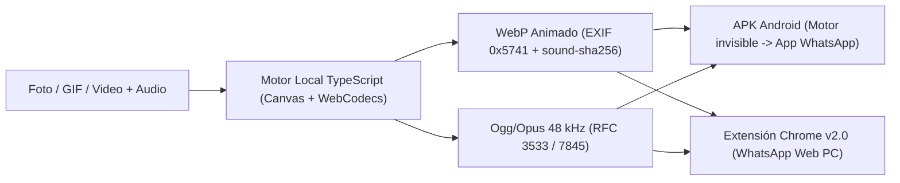

<div align="center">


# AudioSticker Studio

**Crea y envía Stickers con Sonido reales para WhatsApp desde Android, Chrome/Edge o Web — 100% local y sin servidores.**

[](https://github.com/Straugter/AudioSticker-Studio/raw/main/AudioSticker-Studio.apk)
[](#pc-web--extensión-de-chrome--edge)
[](#arquitectura)
[](#cómo-funciona)

[Descargar APK (Android)](https://github.com/Straugter/AudioSticker-Studio/raw/main/AudioSticker-Studio.apk) · [Instalar en PC](#pc-web--extensión-de-chrome--edge) · [Compilar desde código](#compilar-la-apk-desde-el-código-fuente)

</div>

---

## Por qué existe este proyecto

La mayoría de apps para "stickers con audio" simplemente exportan un video `.mp4` normal o suben tus archivos a un servidor remoto. **AudioSticker Studio** compila el formato nativo real de Stickers con Sonido de WhatsApp directamente en tu dispositivo, sin FFmpeg y sin depender de terceros:

| Característica | Conversores comunes | AudioSticker Studio |
| :--- | :--- | :--- |
| **Formato final** | Video `.mp4` o `.webp` sin sonido | **WebP Animado (`512×512`, ≤ 1 MB)** + **Ogg/Opus 48 kHz** |
| **Metadatos WhatsApp** | Sin firma de audio | Bloque **TIFF Big-Endian EXIF (`0x5741`)** con `sound-sha256` |
| **Procesamiento** | Servidores externos | **100% local** (WebCodecs `AudioEncoder` + Canvas) |
| **Envío en Android** | Solo comparte video | Motor invisible en segundo plano que **abre tu app oficial de WhatsApp** |
| **Carga de videos** | Lenta / bloquea la UI | Previsualización hardware en **<150 ms** + recepción desde menú *Compartir* |

---

## Capacidades principales

### App Android (`AudioSticker-Studio.apk`)
- **Recepción directa de videos:** comparte un video, imagen o audio desde *Galería*, *TikTok* o *WhatsApp* hacia **AudioSticker Studio** (`ACTION_SEND`) con streaming local sin saturar la memoria RAM.
- **Carga instantánea y uso offline:** interfaz sin CDNs externos (CSS local + codificador MP3 incluido), optimizada para pantallas desde 320 px (iPhone SE) hasta teléfonos altos con notch/Dynamic Island y tablets.
- **Envío real a tu app oficial de WhatsApp:** tras vincular tu cuenta **una sola vez** (código de 8 dígitos), los stickers con sonido se envían en segundo plano al chat que selecciones (o a tu chat *Tú*) y la app abre directo **WhatsApp** sin volver a mostrar WhatsApp Web.
- **Alternativa sin vinculación:** botón directo para compartir el video-sticker cuadrado `.mp4` mediante el selector nativo de `com.whatsapp`.

### Editor visual y de audio
- **Entradas compatibles:** imágenes (`PNG`, `JPG`, `WebP`), `GIF` animados y videos (`MP4`, `WebM`, `MOV`).
- **Herramientas de sticker (`512×512`):** recorte táctil 1:1, eliminación automática de fondo (por bordes o croma) con cuentagotas, borde blanco troquelado, rebote reactivo al volumen (*Beat Bounce*), texto meme, zoom y rotación.
- **Recorte de audio de precisión:** forma de onda con zoom (`1×`, `4×`, `12×`), deslizador de posición, duración (`5s` / `10s`), ajuste fino (`±0.1s`, `±1s`), volumen y *fade* suave.
- **Fuentes de sonido:** audio extraído automáticamente del video, archivos locales, enlaces de `myinstants.com`, grabación de voz con micrófono y 5 efectos sintetizados integrados.

### Formatos de exportación
- **Par oficial WhatsApp:** `.webp` animado con EXIF `0x5741` + pista `.ogg` Opus 48 kHz.
- **Video-Sticker `.mp4`** (H.264 + AAC, con copia directa de archivo al portapapeles en Windows para pegar con `Ctrl+V`).
- **Video `.webm` transparente** (VP9 con canal alfa + Opus).
- **Paquete editable `.stiksound.zip`**, además de `.webp` estático (≤ 100 KB), `.mp3` y `.wav`.

---

## Cómo funciona



---

## Instalación

### Android (APK lista para usar)

1. Descarga **[AudioSticker-Studio.apk](https://github.com/Straugter/AudioSticker-Studio/raw/main/AudioSticker-Studio.apk)** en tu teléfono e instálala.
2. Abre la app o comparte cualquier video directamente desde tu galería hacia **AudioSticker Studio**.
3. Ajusta el recorte de audio y pulsa **Enviar Sticker Real a App WhatsApp**.
4. La primera vez vincula tu cuenta una sola vez con el código de 8 dígitos (*WhatsApp → Dispositivos vinculados*). A partir de ahí, el envío ocurre en segundo plano y abre tu aplicación oficial de WhatsApp automáticamente.

### PC (Web + Extensión de Chrome / Edge)

```bash
git clone https://github.com/Straugter/AudioSticker-Studio.git
cd AudioSticker-Studio
npm install
npm run build
npm start
```

1. Abre `http://localhost:3000`.
2. Para enviar Stickers con Sonido reales desde PC:
   - Entra a `chrome://extensions/` (o `edge://extensions/`).
   - Activa el **Modo de desarrollador**.
   - Selecciona **Cargar descomprimida** y elige la carpeta `chrome-extension/`.
   - Abre o recarga `https://web.whatsapp.com`.

### Compilar la APK desde el código fuente

Requiere **Node.js 20+**, **JDK 21** y **Android SDK**:

```bash
npm install
npm run typecheck
npm run cap:sync
cd android
./gradlew assembleDebug
```

La APK generada queda en `android/app/build/outputs/apk/debug/app-debug.apk`. También se incluye el flujo automático de compilación en `.github/workflows/build-android-apk.yml`.

---

## Arquitectura

```text
├── src/
│   ├── main.ts                    # Controlador UI, video en vivo, waveform y puente nativo
│   ├── media-engine.ts            # Recorte 1:1, caché de sprites, recorte de fondo y muxers MP4/WebM/ZIP
│   ├── whatsapp-sound-sticker.ts  # Codificador Ogg/Opus + TIFF EXIF 0x5741 + WebP Animado
│   ├── webp-riff-audio.ts         # Lectura e inyección binaria RIFF WebP
│   ├── myinstants.ts              # Extractor de enlaces de MyInstants
│   ├── presets.ts                 # Efectos de sonido sintetizados y assets demo
│   └── types.ts                   # Tipos y límites del formato WhatsApp
├── chrome-extension/              # Extensión Manifest V3 (v2.0)
├── android/                       # Proyecto Capacitor 8 + puente Java nativo (MainActivity.java)
├── .github/workflows/             # Build automático de la APK en GitHub Actions
├── index.html & styles.css        # Interfaz responsive offline (sin CDNs)
├── server.js                      # Servidor local + portapapeles de archivos en Windows
└── AudioSticker-Studio.apk        # Compilación Android lista para instalar
```

---

## Créditos y aviso legal

- Inspirado en la documentación de formatos de [Shirtep/WA-audio-stickers](https://github.com/Shirtep/WA-audio-stickers) y el flujo de trabajo de [SilverFeit/StikSound](https://github.com/SilverFeit/StikSound).
- Proyecto independiente de código abierto con fines educativos y creativos. No está afiliado ni respaldado por WhatsApp LLC ni Meta Platforms, Inc.
